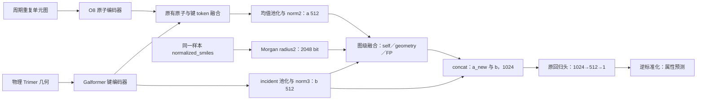

# FP 进入最终图级融合的设计附件

> 历史设计附件：首轮FP-GRAPH f1后来已实际执行，NULL/REAL_MEAN/REAL_KFUSE正式macro R²分别为0.778/0.776/0.739，独立审查未关闭。文中“未执行”是设计时快照；可选masked-FP预训练没有执行。当前主线是UA_2D轻量FP GATE与P2 ALIGN20k，见[当前架构](docs/research/MODEL_ARCHITECTURE.md)和[实验目录](docs/research/EXPERIMENT_CATALOG.md)，本附件不产生新授权。

设计 ID：**FP-GRAPH-20261017 / design1**。日期：2026-10-17。状态：**待授权（实现／实验）**；本轮完成的是静态设计，没有实现模型、运行测试或启动实验。

授权来源：用户要求重新设计“FP 模态进入最终图级融合，类似 MIPS KFuse，并考虑预训练”的方案。本附件只承载设计；`CURRENT_PLAN.md` 仍是唯一执行交接记录，本附件不产生实现或实验授权。

本次读取到 r16 控制器的执行账本仍处于 FT，而 `CURRENT_PLAN.md` 首页仍写待授权，二者不一致。控制器收尾会写该文件，因此本附件独立保存，避免与现有执行者同时修改交接。该状态只描述读取时的证据，不构成持续监控，也不代表 r16 已完成。后续执行者先接收其真实交接，再把本方案的已获授权范围写入 `CURRENT_PLAN.md`；不得中断、重跑、覆盖或改用 r16 的模型作为本方案 parent。

## 1. 结论与范围

推荐先验证：**保留 G05 的原子—物理键 token 融合，在最终图级读出后增加 FP 模态，用 MIPS 风格的多候选注意力残差融合，输出一个神经回归结果。** 七任务采用同一结构、FP 定义和融合规则；每个 task／fold 仍独立训练，不改成多任务学习，也不按任务选择融合方案。

这与 r10 的 `0.75 G05 + 0.25 KRR` 不同：r10 融合两个已产生的属性预测；本方案让 FP 的投影、融合权重和神经回归头共同接受属性损失。首轮新模型输出不再叠加 KRR，旧 KRR 只作已有结果参照。

首轮只做一个有限的三臂 FT 对照，**新增 PT 为 0**。预训练方案在第 7 节给出，但不是自动续跑队列；首轮交付和独立审查后，才决定是否需要另一个明确授权的 PT 周期。它不属于已经关闭的第一阶段调参。

## 2. 已核实的依据与尚未证明的假设

| 项目 | 依据与含义 |
| --- | --- |
| 现有纯神经参照 | G05 step5000，七任务五折 macro R² **0.782**。保留其编码器、token 融合、图读出和训练配方。 |
| 当前统一政策参照 | r10，固定 `0.75 G05 + 0.25 KRR`，macro R² **0.796**。相对 G05 的原精度差格式化为 **+0.014**；这只能支持继续研究 FP 分支，不能证明 FP 特征融合一定有效。 |
| 历史 FP 目标 | `PROJECT_HISTORY.md` 已有 B_FP 辅助预测周期；它是 FP 预测目标，不是本方案的“FP 作为输入参与最终图级融合”。不能把已有 FP 目标换名后当作全新机制。 |
| 已有 KFuse | `src/modules/original_mips_knowledge_fusion.py` 可对多个知识模态做注意力残差；`src/modules/glt_dual.py` 的已有接法主要把图级知识广播给原子。本方案改在图级执行，不声称是已有接法原样开启。 |
| FP 的信息来源 | Morgan FP 由已有结构确定，提供固定局部环境表征及归纳偏置；不是新增实验测量，也不保证包含图结构之外的新信息。KRR 的邻域归纳偏置及预测平均效果不会自动被 FP 投影继承。 |
| 其他候选 | 不把 r13 Huber、r14 Norm、r15 蒸馏或 r16 非键距离与本方案叠加，避免把多个因素的变化归因给 FP。 |

论文 MIPS 使用拓扑表示查询空间描述符的跨模态注意力，并用融合后的原子表示进行 masked-atom 预测；论文并没有直接证明这里的 Morgan 图级三路融合。[MIPS 方法 3.3—3.4](https://arxiv.org/html/2507.20326v1)

本项目实现还有自己的具体约定：512 维 query 输入、128 维 Q/K、按 √512 缩放、512 维 V，以及 0.5 残差系数。新方案保留这些本地约定；图级位置、self 候选、FP 输入及零 V 初始化是本项目改造，不能称完整复现论文。

本轮核对的是相关代码、现有结果及元数据；没有重新运行历史模型、测试或重新评估其预测。共享 validation／TEST 已参与开发，未来结果仍为探索性比较。

## 3. 图级架构



### 3.1 输入与 FP 语义

- 原图和几何输入沿用 G05；不改构象、原子映射、连接点、过滤、坐标或 token 级融合。
- FP 沿用 `src/training/xc_kernel.py` 的 Morgan 定义：radius=2、2048 位、二进制、chirality／bond type／ring membership 开启，保留 `normalized_smiles` 中的 dummy connection atoms。保持 RDKit 与当前环境一致，不切换 radius3、不增加描述符或计数 FP。
- FP 必须来自该样本对应的结构字符串；不替换成不同重复次数或不同连接点处理的 SMILES。本轮不增加 repeat／shift 增强，不宣称 FP 具备周期表示的不变性。
- Dataset 增加 `fp_bits`，单样本形状 `[1,2048]`，batch 后 `[B,2048]`。FP 不使用标签、TEST 分布统计、跨 fold scaler 或 KRR 的监督参数。
- 实际输入按自身 L2 范数归一化：`p = √512 × x_in / ‖x_in‖₂`。这是单样本确定性变换，不拟合总体统计；不得用未遮蔽目标 FP 的激活位数量作归一化依据。真实 FP 全零／非法结构是错误，不静默填值。
- 常量对照令每位 `x_in=0.5`；这是一致的非信息输入，不表示结构缺失。所有三臂的 FP availability 均为真，不用删除模态替代常量对照。

### 3.2 融合公式

a 是原有 token 融合后池化并经过 norm2 的 512 维图表示，已经包含已有几何融合结果；b 是原有 incident 几何读出经过 norm3 的 512 维表示，不把 a 简称为未经融合的纯 2D 特征。

三个候选为 k_self=a、k_geometry=b、k_FP=p；候选输入维度分别为 512、512、2048。每个候选有独立 K、V 投影，query 来自 a。

$$
q = W_q a / \sqrt{512}, \qquad
\ell_j = q^\mathsf{T} W_{K,j} k_j, \qquad
\omega_j = \operatorname{softmax}_{j \in \mathcal A}(\ell_j)
$$

$$
a_{\mathrm{new}} = a + 0.5\sum_{j \in \mathcal A} \omega_j V_j(k_j),
\qquad h_{\mathrm{new}}=[a_{\mathrm{new}};b]
$$

$$
\hat y_{\mathrm{std}} = \operatorname{MLP}_{1024\rightarrow512\rightarrow1}(h_{\mathrm{new}})
$$

这里的 attention 沿候选模态维度计算，每个样本可以有不同权重；它不是 r10 神经／KRR 预测权重，也不直接把注意力当作因果贡献。

**保留 self 候选的原因**：只提供一个 FP 候选时，softmax 恒为 1，不能学到模态选择；如果只有 FP 和 geometry，几何无效时也会退化成强制使用 FP。self 始终有效，让几何缺失时仍有两个可选择项。

几何 availability 取 `encoder.encode()` 得到的有效标记，包含 incident 读出是否实际可用。无效几何 b 在 norm3 后再次置零，并屏蔽整个 K/V 候选，包括 V 的 bias；不能仅将原始几何输入置零而留下投影 bias。非法 FP 不作为“缺失模态”吞掉。

### 3.3 初始化与参数

- 原 G05 encoder 和每个 task／fold 的原始 head 初始化完全沿用，先严格加载旧结构，再接入新模块；不修改旧 checkpoint。
- 新模块初始化独立使用固定 CPU seed `20261017`，在隔离的 RNG 上下文创建，不消耗 FT 的 `42+fold` 随机序列。三臂及各 task／fold 复用同一份新模块初态。
- **三个 V 投影的 weight 和 bias 全部置零**；Q/K 使用同一份常规初始化。于是最初 `a_new=a`，真实／常量 FP 及固定／注意力融合均从 G05 相同预测函数起步。
- 第一个 backward 中 Q/K 的梯度可为零，因为 V 为零；V 更新后 Q/K 才有有效梯度。不能把第一步 Q/K 为零判成错误，也不能误把 V 全冻结。
- 不新增 LayerNorm、可学习温度、额外 FP MLP 或融合 dropout；避免顺带增加可调因素。

| 新增参数 | 形状规则 | 数量 |
| --- | --- | ---: |
| Query | 512→128，无 bias | 65,536 |
| 三组 Key | 512／512／2048→128，无 bias | 393,216 |
| 三组 Value | 512／512／2048→512，有 bias | 1,574,400 |
| 新图级融合合计 | 上述相加 | **2,033,152** |
| 新神经模型总参数 | 39,876,344 + 2,033,152 | **41,909,496** |
| head 阶段参数 | 原回归头 525,313 + 新融合 | **2,558,465** |

这些数量由当前层形状推算，**尚未用新实例验证**；执行时由实际参数及优化器分组记录确认，不把设计数字当作已实现证据。小样本下新增约 203 万参数可能过拟合，这是需要匹配对照和正式结果回答的风险，不预先承诺优于 KRR。

## 4. 首轮科学问题、对照与判定

| 项目 | 预先固定的内容 |
| --- | --- |
| scientific question | FP 作为图级输入能否改善七任务迁移？改善是否需要按样本选择模态的 KFuse？ |
| reference | 新的同容量常量 FP 臂用于机制比较；复用 G05 纯神经及 r10 统一预测融合用于项目性能比较。 |
| controlled change | 真实 FP 对常量 FP；在真实 FP 下，注意力 softmax 对固定均匀融合。除此之外同结构、同参数初态、同训练与选择规则。 |
| comparison budget | 七任务×五折×三臂；同 split、原 G05 step5000、原 fold head、seed42+fold、train-only scaler、完整 R0 FT 配方与验证次数。 |

| 臂 | FP 输入 | 模态权重 | 目的 |
| --- | --- | --- | --- |
| `FP_NULL_KFUSE` | 全 0.5 | 有效模态间 softmax | 保留相同新增层及可学习路由，估计无真实 FP 信息时的变化。 |
| `FP_REAL_MEAN` | 真实 FP | 有效模态间严格均匀 | 判断直接引入 FP 是否有效，避免把所有收益归因给 gate。 |
| `FP_REAL_KFUSE` | 真实 FP | 有效模态间 softmax | 预先指定的主候选，检验自适应图级融合。 |

三臂都构造并计算相同的 Q/K/V 投影；MEAN 臂只将最后的权重替换为有效候选上的均匀权重，不删除 Q/K 参数。其 Q/K 不影响预测、因而不获得属性梯度，这是有意的路由消融；**相同参数张量数不等于相同有效函数容量**。禁止用随机 FP／打乱标签替代常量臂，禁止按任务回退或用 TEST 选臂。

主要报告：

1. `REAL_KFUSE − NULL_KFUSE`：同一自适应结构下真实 FP 的差异。
2. `REAL_KFUSE − REAL_MEAN`：自适应权重相对固定融合的差异。
3. 三臂分别对 G05 及 r10 的原精度逐折／逐任务差异。

项目性能里程碑仍为主候选相对 r10 的 macro R² **≥+0.010**；真实 FP 机制支持还需主候选相对 NULL 的 macro R² **≥+0.010**。自适应权重是否有额外收益单独报告，不把前两个比较拼成未经组合消融验证的 interaction。满足门槛仍需审查，不自动部署。

如果 MEAN 与 KFuse 都优于 NULL，但 KFuse 不优于 MEAN，只能支持使用 FP，不能宣称 gate 有效；不得在看到 TEST 后切换主候选。如果仅 NULL 改善，说明新增图级模块本身可能有用，不能归因于真实 FP。若主候选未达门槛，关闭本轮，不追加权重／温度／维度网格。

## 5. FT 的必要工程改动

### 5.1 head 与梯度路径

新增私有 wrapper，`model.model` 保留 G05 encoder，`model.head` 包含“新图级融合＋原回归器”。将 encoder 内原 predictor 转移到 `head.regressor`，原注册位置替换为 Identity，避免同一参数被重复注册或重复优化。每个 fold 的旧 `head_initial.pt` 只严格加载进 `head.regressor`。

wrapper 一次 `encode`、一次原 `fuse` 得到 h=[a;b] 及真实 geometry_valid，再把 h、FP、availability 送入新 head。复用 `periodic_tdl_head(model)` 的已有接口和 `fce_param.py` 的两阶段训练：前 10 epochs 训练**新融合和原回归器**，joint 阶段解冻全部 encoder。不能把新增融合放在被冻结的 encoder 内而让它错过 head 阶段。

原有 `HeadFeatureCache` 只承载旧 head 输入，不能照搬用于缓存新增模块之后的图表示；这会丢失 FP／availability 或切断融合梯度。首轮采用最小方案：**新 wrapper 不提供 feature_cache_context，禁用其旧 head cache，冻结阶段在线前向原 encoder**。原编码器无梯度、eval；不增加训练轮次，也不建设新缓存框架。相比 G05 旧缓存执行，前向计算量会增加，不能仅凭 update 数声称墙钟时间相同。

### 5.2 固定训练与选择

- parent：`results/fce_tune_20261015/t3b/pretrain/T3B_G05/deploy_05000.pt`，不换 r15／r16 parent。
- 原 head：`results/glt_fusion_20261007/r1/finetune/B0/<task>/fold<fold>/head_initial.pt`。
- 沿用七任务原 split；每 fold seed 为整数 `42+fold`，元数据中的规则字符串仅用来描述，不能把字符串直接转整数。
- 标准化 MSE，train-only StandardScaler，batch24、FP32、clip5、workers0；encoder dropout0；沿用 `recipe_for('R0', task)` 的 head dropout／weight decay／LR／scheduler。
- head10 epochs；joint 为 Egc50、其他60。head 阶段 head 组 LR=3e-4；joint 新融合与旧回归头同属 head 组 LR=1e-3，backbone 为原任务配方。沿用原优化器重建与 scheduler 语义，不加早停、额外 seed 或新的 loss。
- 每臂各 task／fold 独立按原单位 validation RMSE 严格取最小值，保留最早的严格最优项；不是按融合输出或 TEST 分数挑 best。
- 全部 **105 份 best、scaler、配置、输入策略及初态路径记录冻结后**，才开始本周期新的 TEST 读取／forward。冻结以内容记录和固定选择实现，不计算任何文件 hash／checksum，不用旧 hash 合同作门槛。
- 正式每个 best 只做一次神经 TEST forward，逆标准化后存一组新预测数组。旧 G05／r10 预测与评估结果只引用复用，不重跑；不新算 KRR 或候选再加 KRR 的输出。

## 6. 允许修改、预算、运行与交付

### 6.1 实现范围

授权执行后拟新增以下文件，名称是设计，当前不存在可直接运行的新入口：

| 文件 | 职责 |
| --- | --- |
| `src/modules/fp_graph_fusion.py` | 窄范围图级 KFuse／MEAN head，复用既有 KFuse 约定，不改旧模块默认行为。 |
| `src/training/fp_graph_fusion.py` | 私有 wrapper、FP 数据附加、固定三臂策略、参数／优化器分组记录。 |
| `scripts/run_fp_graph_fusion_unit.py` | 一个明确 task／fold／arm 的 FT 或冻结后单次预测。 |
| `scripts/run_fp_graph_fusion.py` | 有界调度、全矩阵冻结、已有参考数组读取、汇总及真实退出记录。 |
| `tests/test_fp_graph_fusion.py` | 最终一次性窄 CPU 正确性检查。 |
| `CURRENT_PLAN.md` | 在 r16 执行者完成交接后，记录本周期的实际授权、状态、预算、日志及七任务交付。 |

旧共享科学实现、旧 checkpoint／KRR／预测／split、模型历史和 SOTA 表均只读。复用可直接调用的现有函数，不顺手重构旧控制器；若某个旧运行入口会执行文件哈希，不调用那条校验路径，也不复制进新实现。

### 6.2 硬预算

| 项目 | 首轮上限 |
| --- | ---: |
| 新 PT／PT validation／teacher／新构象 | **0** |
| 新 FT | **105**：三臂各35，task／fold／seed不扩大 |
| FT epochs | **7,200**：三臂各2,400 |
| attempted／completed optimizer updates | **154,350／154,350**：三臂各51,450；失败尝试也计预算 |
| 新 validation 轨迹／best | **105 份**；每 epoch 原配方 validation，不另加轮次 |
| 正式神经预测单元／新数组 | **105／105**；只存各臂纯神经输出，非旧流程的双政策数组 |
| 新 KRR fit／refit／forward | **0／0／0** |
| 下游 FP 计算 | 允许复用语义明确的已有 bit 数组；必须新生成时，对遇到的 normalized_smiles 单次缓存，**最多5,875个不同字符串**。只对当前单元允许的数据角色取值，不提前物化其 TEST 输入。记录实际计算数与命中数，不计算文件指纹。 |
| FT 数据行缓存 | 每臂 train＋validation 合计最多23,500份图记录，TEST最多5,875份；三臂分别不超过70,500／17,625。不是额外样本或额外训练预算。 |
| GPU | **仅2／3，每卡最多4路，合计最多8路**；不抢占已有作业 |
| DataLoader worker | **0** |
| 最终 CPU 检查 | **一次**，仅新测试文件，timeout300秒 |

已有任务数合计为5,875，FP唯一字符串通常不多于该值；不能把已有特征命中记成新生成。跨 fold 样本可能以不同角色出现，缓存键／行绑定必须保留该 task／fold 的原始行索引和样本身份，不能由“别的 fold 已训练”推断本 fold 可提前读 TEST。由于数据早已开发暴露，这些约束保护本周期流程，不能恢复盲测性质。

本方案不承诺完成小时数；失去 head 缓存后不能用旧每步耗时直接外推。执行中只复用正常训练日志记录耗时，不追加 benchmark 或安排定时监控。

### 6.3 日志、停止条件与最终测试

拟产物根：`results/fp_graph_fusion_20261017/f1/`；日志根：`logs/fp_graph_fusion_20261017/f1/`。若目录已被别的周期使用，不覆盖、不清空，先说明实际冲突。

所有预计超过一分钟、GPU 或写训练产物的工作都放在 `tmux` session `Uni-Poly` 的独立 `fp_graph_f1_*` windows，保留工作目录、命令、日志、真实退出码、预算、105单元模型／预测索引、冻结记录、逐折差和交付报告。tmux 不可用则报告阻断，不改用无日志后台。

遇到数据／parent／head／模型 schema 不匹配、错误 FP 位／行绑定、NaN／Inf、梯度路径被切断、重复参数注册、writer 冲突、正式输出覆盖风险、提前 TEST 或预算越界时，停止受影响运行，保留现场；不能静默跳过、填充、换配方或自动重跑。低分本身不授权新增候选。现有已成功单元不能为补日志而重训。

全部授权实现、训练和正式预测完成后，只运行一次新 CPU 测试文件。用小张量／fake encoder／少量 fixture 覆盖本次实际问题：

1. FP 生成参数及 dummy 保留、bit／行／batch 对齐、归一化、常量输入、非法值拒绝。
2. 三候选公式和固定 MEAN、几何屏蔽含 bias、无有效 geometry 时仍有 self／FP 两候选；零 V 时保留原表示；V 非零时 FP 能改变输出。
3. 三臂共同初态、旧 regressor 严格加载、唯一参数注册、head／joint 优化器分组；梯度可到新融合，backbone 在 head 阶段冻结；Q/K 梯度检查使用非零 V fixture。
4. 新 wrapper 一次 encode／fuse、FP 与真实 availability 到达 head、不进入旧 feature cache、checkpoint 往返保留新结构。
5. 全部105项冻结前不进入 TEST、一次预测与预算上限、旧数组只复用，以及原精度指标汇总。

不在实现中先跑分项测试／smoke／GPU探针／回归，也不为满足历史合同建立文件哈希清单。测试失败时状态为“需返修”，记录具体影响，不自动修复重测。独立审查只读实际 diff、这一次测试与已有日志／产物，不重复跑科学流程。

### 6.4 七任务交付与当前执行记录

| 任务 | 论文最佳模型 | 论文 R² | 本轮三个臂 R²／RMSE／std、差值 |
| --- | --- | ---: | --- |
| Eea | Periodic-TDL | 0.934 | 未完成／不可比较：尚未授权实现和实验 |
| Egb | Periodic-TDL (+Chem, +RC) | 0.923 | 未完成／不可比较：尚未授权实现和实验 |
| Egc | Periodic-TDL (+Chem, +RC) | 0.911 | 未完成／不可比较：尚未授权实现和实验 |
| Ei | Periodic-TDL | 0.839 | 未完成／不可比较：尚未授权实现和实验 |
| EPS | Periodic-TDL | 0.787 | 未完成／不可比较：尚未授权实现和实验 |
| Nc | Periodic-TDL | 0.856 | 未完成／不可比较：尚未授权实现和实验 |
| Xc | Periodic-TDL | 0.423 | 未完成／不可比较：尚未授权实现和实验 |

论文目标取自 `SOTA_RESULT.md` 当前各任务最佳均值及对应模型，不替换为 MIPS 另一张表。最终填入三个新臂每任务五折、每折单次 seed42+fold、std ddof=0、七任务等权 macro；先按完整精度算差，再展示三位小数。逐项给出对论文、G05、r10及两个机制对照的差异，另报35折改善／退化数量、去掉最大增益任务后的 macro 差；RMSE 下降才是改善，不跨物理单位平均 RMSE。

不能因某任务退化就隐藏或切回旧预测；论文协议等价性未核实，仅数值对照，不称公平超过论文或独立盲测。当前本方案实际 PT／FT／fit／模型 forward／正式预测／CPU 测试／GPU／worker 消费全部为 **0**；没有新实验日志或结果文件，纯文档不写入模型历史。

## 7. 可选的预训练设计：有图级监督，但不允许复制完整输入

本节是设计备选，**当前实现与执行预算均为0，不随首轮自动启动**。

### 7.1 为什么“把 FP 加到 PT 输入”本身不够

原有 masked-atom CE 与局部几何损失作用于图级读出之前。将 FP 只加入最后的图级融合，不改变这些局部损失时，新增 graph KFuse 不在损失路径上，无法学到新参数。因此不能仅打开 FP 输入，然后宣称已经预训练了融合模块。

另一个错误是把完整 FP 作为输入，同时让同一路图级输出重建完整 FP；模型存在直接复制该输入的捷径。历史纯图→FP 辅助预测与这种“输入包含目标”的问题要分开处理。

### 7.2 推荐目标：masked-FP 图级重建

- 仍使用同一 graph KFuse 和 Morgan2048，随机独立遮蔽50%的 FP 位；被遮位用 **0.5** 表示未知，未遮位保留0／1，输入维度不增加。
- 仅用遮蔽后的 FP 计算输入范数；不能通过完整 FP 激活数或另一条 clean FP 旁路泄露目标。
- 在融合后 `h_new` 上加 PT 专用 decoder：1024→256→2048 logits，GELU，无额外 dropout。推算新增788,736参数，FT／部署丢弃这个 decoder。
- 只对被遮位置计算 BCEWithLogits。每图分别平均被遮正位与负位损失，再对非空类别等权平均、最后按图平均；某类不存在时不除零，也不把缺失类别固定计成零。掩码和实际计数均保留诊断记录。
- 原 atom CE 和 geometry 仍取原来的 token／原子路径；FP 仅在图级出现，不回灌到 masked-atom 分类器。新增目标由融合后的 h_new 解码，梯度确实经过 graph KFuse／FP 投影／图读出，而不是另接一个绕过融合的 FP head。

$$
\mathcal L = \mathcal L_{\mathrm{atom\ CE}}
+0.5\mathcal L_{\mathrm{geometry}}
+\lambda(t)\mathcal L_{\mathrm{masked\ FP}},
\qquad \lambda(t)=0.1\min(t/1000,1)
$$

FT 时回到完整 FP，不再应用 bit mask。50%位遮蔽、λ上限0.1和1000步爬升均是待验证的设计值，不是已证明的最优值，不为此安排网格。

### 7.3 PT 必须匹配的对照

若首轮审查后决定执行 PT，另立两臂 `PT_LOCAL`（λ=0）与 `PT_MASKFP`（上述 λ），使用同样的新架构、遮蔽输入、decoder 计算、原 parent、数据顺序、初始化、训练步数和 FT。仅改变新损失的权重；λ=0 臂必须正确处理未参与梯度的新增参数，不能为避免 unused 参数而偷偷改变目标。

新增了融合和 decoder，不能套用旧 schema 然后声称完整恢复了 G05 原 optimizer。可以设计为两臂同样从 G05 完整模型权重 warm-start，并同样重新初始化 optimizer／LR；此时必须明确称 warm-start 新周期。是否采用这种方案、数据绝对位置、world size、LR轨迹、PT steps／validation及后续70FT预算，需要在该周期的可执行交接中单独固定。

本附件不授权接续旧控制器、不预留自动消费的PT额度。即使未来“带PT的FP融合”有收益，也要与等时长 `PT_LOCAL` 比较，不能把相对旧G05的变化全归因给 masked-FP 目标。

## 8. 其他融合方案的取舍

| 方案 | 本设计的判断 |
| --- | --- |
| 直接 concat 图表示与 FP 后接 MLP | 有效的简单备选，但改变 head 输入维度及容量；首轮用同投影的 REAL_MEAN 作为固定融合对照，避免再加第四臂。 |
| 对 G05／KRR 预测学习 sigmoid gate | 仍是两个预测器的输出融合，需要处理 gate 的训练标签与 OOF 预测泄露；与本次“FP进入图级表示”的问题不同，不在首轮实现。 |
| 直接用完整 FP 重建完整 FP | 易有复制捷径，不采用。 |
| FP 只作为图→FP 的 PT 标签，FT 不输入 FP | 与已有 B_FP 更接近，不能回答图级输入假设，不作为本轮主方案。 |
| masked-FP 图级重建 | 能训练新增图级融合的独立备选；先有机制设计，执行需另立匹配 PT 周期。 |

## 9. 首轮执行提示词（本轮未执行）

```text
请实施 FP_GRAPH_FUSION_DESIGN.md 的 FP-GRAPH-20261017 / design1 第3—6节首轮三臂实验。此次指令授权其中列明的最小代码、105 FT、冻结后105次正式神经预测和最终一次CPU测试；第7节PT及第8节其他方案均不授权。

先查看git status和相关diff，保护所有已有改动。r16此前可能仍在执行且控制器会写CURRENT_PLAN.md：先读取已有真实交接，若尚未完成，不中断、不抢占、不同时修改CURRENT_PLAN.md或训练产物；报告具体冲突并停止本周期启动，不安排定时监控。无并行writer且旧周期已交接时，将本次授权范围写入CURRENT_PLAN.md，它仍是唯一执行交接记录。

固定FP_NULL_KFUSE、FP_REAL_MEAN、FP_REAL_KFUSE三个臂，统一覆盖Eea/Egb/Egc/Ei/EPS/Nc/Xc五折，seed42+fold。parent只用原G05 deploy_05000.pt，每个fold复用原B0 head_initial；不混用r13—r16改动。FP保留现有Morgan radius2/2048/chirality/dummy定义。图级query=a，候选self=a、geometry=b、FP；按本附件Q/K/V、可用性屏蔽、0.5残差、零V初始化和FP归一化实现。主输出为一个神经回归结果，不叠加KRR。

新增融合必须与原回归器一起进入model.head，head10阶段就训练；旧encoder predictor转移后用Identity避免重复注册。新wrapper不启用旧HeadFeatureCache，在线冻结encoder前向。保留R0每任务原loss/scaler/LR/WD/dropout/scheduler/batch24/FP32/clip5/epoch，workers0，不增加调参、seed或早停。

硬预算105FT、7200epochs、154350 attempted/completed updates，105份best全体冻结后才读本周期TEST，各单元一次forward，共105组纯神经正式预测数组。新增PT、teacher、新构象、KRR fit/refit/forward均0。特征缓存和生成按第6节上限记录实际消费，不计算文件hash/checksum，不新增指纹清单，不执行旧hash合同。GPU2/3每卡最多4路，总8路，不抢占已有作业。

所有长任务/GPU/训练写入均在tmux Uni-Poly独立fp_graph_f1_* windows保留命令、cwd、日志和真实exit，使用附件指定的新results/logs目录；不存在入口先实现，未知旧目录不覆盖。异常按停止条件保留现场，不自动重跑或增加预算，不安排定时监控。

全部授权实现、科学执行完成后，只运行一次tests/test_fp_graph_fusion.py，timeout300秒，不先跑smoke/分项测试/旧回归/GPU探针。失败标需返修，不自动修复重测。

交付三臂完整R²/RMSE mean±std、七任务论文参照及差值、对G05/r10和两个机制对照的原精度差、35折改善/退化及收益集中度；全部展示三位小数，std ddof=0。共享TEST已开发暴露，只称探索性比较。主候选固定REAL_KFUSE，禁止按TEST切臂、按任务回退、隐藏退化或自动部署。最终更新CURRENT_PLAN.md为待审查或真实失败状态并给出实际diff、预算、冻结/模型/预测索引、测试和真实退出证据；不要自行写PROJECT_HISTORY.md/SOTA_RESULT.md，不删除、pull、commit、push，不启动下一个候选或PT。
```

当前审查结论：设计已完成，模型可行性与性能尚未实测。首轮和可选 PT 的授权边界分开；不把设计参数量、公式或历史结果写成新模型测试通过。
