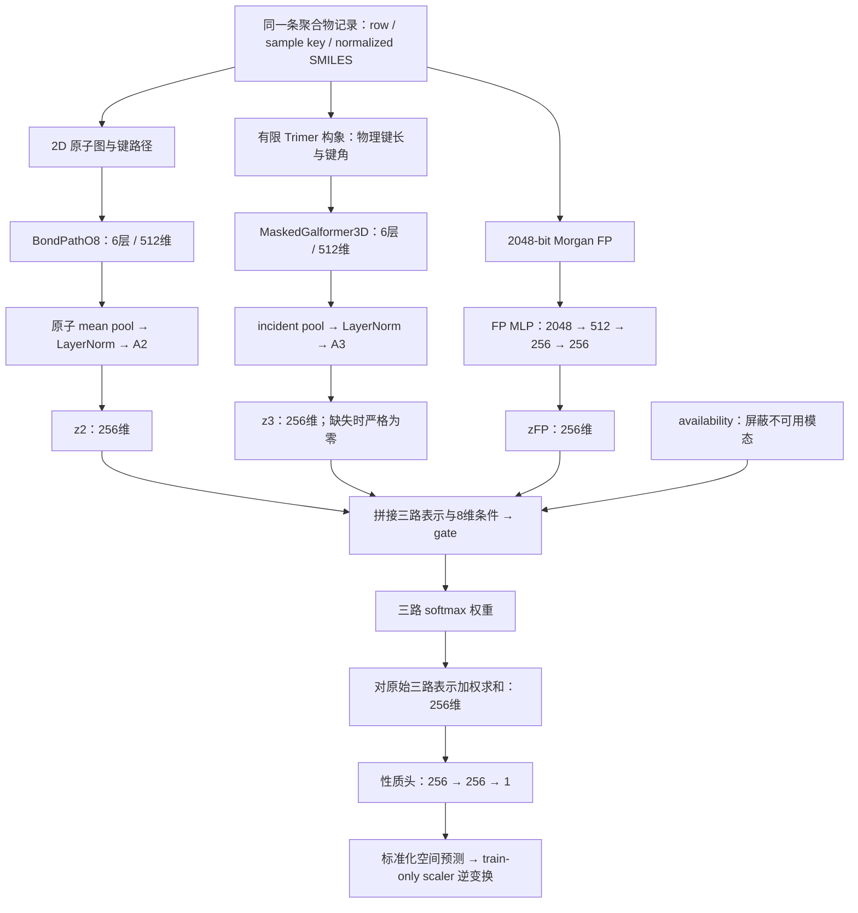

# 当前 BASE 完整模型流程

核对日期：2026-10-29（Asia/Shanghai）。本文依据当前工作树源码、实际配置及已完成的 r6 产物说明模型；属于流程文档，不产生训练、TEST、复测、换卡或预算授权。执行范围仍以 [CURRENT_PLAN.md](CURRENT_PLAN.md) 为准。

## 1. BASE 的准确身份

当前 BASE 是用户于 2026-10-28 指定的 **UA3D-BASE-OPT-20261026-01/r6/F_PD_N1_F0**，包括一份三模态预训练 endpoint，以及由它分别微调得到的七任务×五折、共 35 个 BEST 模型。

| 项目 | 当前值 |
|---|---|
| 模型架构 | 原生 TMOL3M：BondPathO8 2D＋MaskedGalformer3D 3D＋Morgan FP＋门控融合＋标量回归头 |
| 配方 ID / PT endpoint ID | `F_PD_N1_F0` |
| 原始正式 TEST macro R² | **0.805**；reference 完整精度为 `0.804675462276949` |
| validation macro R² | 0.808；原始值为 `0.8078628628513551`，不代替 TEST |
| 任务 / fold / seed | Eea、Egb、Egc、Ei、EPS、Nc、Xc；fold0—4；FT seed=42+fold |
| 评价性质 | 共享开发评价；用户在查看 TEST 后指定为后续 reference |
| 独立审查 | `independent_review=PENDING` |

本文使用以下路径缩写；它们只是阅读别名，实际文件路径不变：

```text
BASE_ROOT = results/ua3d_base_opt_20261026/r6/repairs/concurrency_r1
R6_ROOT   = results/ua3d_base_opt_20261026/r6
PARENT    = results/ua3m_paperfuse_20261025/r1/repairs/gpu0123_restart1
PT_CACHE  = results/ua2d_pretrain_fp_20261019/fast_r4/prepared_cache
PT_MAP    = results/ua2d_ptscale_20261022/r1/inputs
DOWN      = data/processed/mcl_ph_r4_20260930/downstream_direct_01.staging
SPLIT     = data/splits/mips_paper5_outer
```

最新 BASE 的指定没有改写 r6 原预冻结 `FINAL=E_P_SYM_SHARED`、该周期 `performance_pass=false` 或父运行停止记录。历史 `UA3D-SPATIAL-20261025-01/r4/FULL/BASE` 保留“历史 r4 BASE”身份，正式 macro 为 0.795；本文的当前 BASE 则是 F 配方。

## 2. 从输入到预测的整体信息流



训练分为两个阶段：先在无性质监督的预训练池中训练三路表征，再把同一个 PT endpoint 分别用于 35 个下游 task/fold。各下游模型独立训练；现有正式结果按五折统计，不将五个模型在同一批样本上的预测平均成集成结果。

Q2/Q3 是训练时的对齐投影头：它们作用于 z2、z3、zFP 以计算辅助损失。性质预测直接融合 z2、z3、zFP，预测链路不经过 Q2/Q3。

## 3. 数据、身份和 split

### 3.1 预训练数据

预训练来源为既有 PI1M 处理数据，直接只读复用 `PT_CACHE` 的模板和 `PT_MAP` 的有效样本映射：

- 原缓存有 911,391 条记录；有效几何池为 **910,756** 条，635 条失败几何记录从整个 PT 输入中排除，因此也不参加 2D mask 或 FP ALIGN。
- 采样使用 `OrderedSampleStream(910756, 42)`；每个样本由固定 global position 决定，worker 调度不改变消费顺序。
- 映射顺序为 eligible logical slot → 原缓存 key / source row。logical slot 和 source row 有不同语义，读取时分别核对。
- 同一模板提供 2D 图、物理 Trimer 几何和 packed Morgan bits。FP 从 256 字节 `uint8` 按 little bit order 解包为 2048 维二值输入。
- BASE 复用既有坐标和 FP，不在 PT 中重新生成构象或指纹。

10K PT 共消费 60,000 个 microbatch、10,080,000 次样本展示；这里是重复采样后的 presentation 数，不是独立结构数，也不是“10,000 个 epoch”。

### 3.2 下游数据与三模态对齐

下游性质标签来自 `DOWN`；结构和 FP 来自 `PARENT/inputs` 的已物化三模态缓存。缓存共 **5,875 条任务记录**，其中 5,860 条有 3D，15 条缺 3D；缓存元数据声明 `targets_cached=false`、`label_statistics_fitted=false`。

| 任务 | 总记录数 | fold0 train / validation / TEST | 缺 3D 记录 |
|---|---:|---:|---:|
| Eea | 368 | 235 / 59 / 74 | 0 |
| Egb | 561 | 358 / 90 / 113 | 7 |
| Egc | 3,380 | 2,163 / 541 / 676 | 8 |
| Ei | 370 | 236 / 60 / 74 | 0 |
| EPS | 382 | 244 / 61 / 77 | 0 |
| Nc | 382 | 244 / 61 / 77 | 0 |
| Xc | 432 | 276 / 69 / 87 | 0 |

表中的划分人数仅展示 fold0；其余 fold 必须读取原 `SPLIT/{task}.json`。总体约为 64% train、16% validation、20% TEST，实际以各 fold 的已登记索引为准，不重新随机划分。

数据关联使用 **task＋original row＋sample key＋normalized SMILES**。多模态样本不得仅凭数组位置拼接。不同任务的行数是性质记录数，不能直接解释成互不重复的结构数。

### 3.3 缺失 3D 的处理

15 条缺失记录对应 8 个结构，全部保留在下游评价中：

1. collate 时只有有 3D 的样本进入 3D subbatch，保存其在完整 batch 中的行映射。
2. 完整 batch 的 h3 先置零，有效 3D 编码结果按行写回。
3. A3 投影后再次乘 availability，使缺失行的 **z3 严格为零**，连 Linear bias 也被消除。
4. gate 将缺失模态 logit 设为 −∞；softmax 在剩余的 2D 和 FP 上归一化，3D 权重为零。
5. 涉及 3D 的对齐方向排除这些行；2D→FP 对齐仍可使用它们。

这里不会在线补构象、用别的结构替换、删除性质行，或把缺失 3D 的零向量当作真实几何。

## 4. 三路编码器和融合层

### 4.1 2D：BondPathO8

2D 编码器处理原子特征、骨架标记、局部图关系及键路径特征。原子嵌入维度为 512，使用 **6 层、8 heads、每 head 64 维**的 Transformer。attention bias 包括最短路距离 embedding、节点路径 bias 和共享键路径 bias。

每层保留 LayerNorm、attention 残差和 FFN 残差；FFN 为 `512→2048→512`，激活为 GELU。attention 的 QK 缩放为 **1/√512**，结构 bias 在缩放后相加。源码中的 O8 命名不表示模型有 8 层。

最终对 canonical graph 内原子状态做 mean pool，经过 `norm2=LayerNorm(512)` 和 `A2=Linear(512,256)` 得到 z2。

### 4.2 3D：MaskedGalformer3D

3D 使用 `finite_incident` 几何模式和有限 Trimer 的物理键 token。每个 token 由两个端点的元素信息与键长的 Gaussian 径向编码构造初态；键与键之间的 line-graph 路径提供键角信息，包含路径 angle bias 和 angle-value 注入。随后经过 **6 层、512 维、8 heads**的 Transformer；attention 缩放同样为 1/√512。

这里的 token 表示物理化学键，`triplet_type` 分类由两个端点元素和 bond type 组成；它与输入使用的三重复单元 Trimer 构象是不同概念。

图级读出采用 incident pool：先将与中心重复单元重原子相接的键 token 聚合到对应 canonical 原子，再对有 incident 状态的原子取图均值。经过 `norm3=LayerNorm(512)`、`A3=Linear(512,256)` 和 availability mask，得到 z3。

当前 BASE 使用这条原生键长／键角路径；新增非键半径邻域残差、扭转角目标、PH 分支和其他后续实验臂均不属于此配方。

### 4.3 FP：Morgan2048 MLP

FP 是 normalized SMILES 的 2048-bit 二值 Morgan 指纹，既有定义为 radius=2、`includeChirality=true`、`useBondTypes=true`、`countSimulation=false`；保留原连接 dummy atom 语义。

编码器为：

```text
2048 → Linear(512) → ReLU → Dropout
     → Linear(256) → ReLU → Dropout
     → Linear(256) → zFP
```

两处 Dropout 在当前 BASE 的 PT 中均为 0，在 FT 中均为 0.2。FP 是结构输入并参加跨模态 ALIGN，当前 BASE 不预测或重构 FP bits，`fp_prediction=false`。

### 4.4 TMOL gate 与性质头

每个 task/fold 构造独立的 `Tmol3MGating` 和回归头。gate 包含 `Embedding(1,8)` 的 task number 与 `Embedding(2,8)` 的 task type；当前代码固定使用 number=0、type=1，将两者相加得到 8 维条件向量 e。这里没有把七任务混合训练成共享多任务头。

$$
g = \mathrm{MLP}_{776\to512\to3}([z_2;z_3;z_{FP};e]),\qquad
w=\mathrm{softmax}(\mathrm{mask}(g,\mathrm{availability}))
$$

输入维度为 `3×256＋8=776`。gate 的隐藏激活为 ReLU，融合结果为三路原始表示的加权和：

$$
f=w_2z_2+w_3z_3+w_{FP}z_{FP},\qquad
\hat y_{std}=\mathrm{Linear}_{256\to1}(\mathrm{Dropout}_{0.5}(\mathrm{ReLU}(\mathrm{Linear}_{256\to256}(f))))
$$

当前 `fusion='gate'`，没有 G 阶段的额外 residual 或 modalnorm。gate 权重随输入样本改变，但权重大小本身不能证明某模态的因果贡献。

实际产物记录：PT 模型含 mask heads 共 **47,768,182** 个参数；FT 模型共 **41,325,970** 个参数，其中 native backbone 为 **39,088,502**。这是模型总参数量，不是每个训练阶段均可更新的参数量。

## 5. 公共初始化与 10K 预训练

### 5.1 初始化来源

F 从 `R6_ROOT/initialization/common_step0.pt` 开始完整训练 10K；registry 的 `parent/control=E_P_CURRENT_SHARED` 表示比较关系，不表示从 E 的训练 endpoint 接着训练。

公共 step0 的来源由 `initialize_cycle()` 明确记录：

| 参数部分 | 来源 |
|---|---|
| `o8 / norm2 / encoder3d / norm3` | `results/ua2d_pretrain_fp_20261019/fast_r4/initialization/common_step0.pt` |
| 2D atom mask head、3D line mask head | 同目录 `task_heads/V1.pt` |
| `A2 / A3 / fp_encoder / Q2 / Q3` | `PARENT/initialization/TMOL3M_modal.pt` |

初始化排除 FP prediction head；F 的 `independent=false`，没有独立 QFP。受控接续只读复用已完成的 r6 初始化，不再次 initialize。历史 P10K checkpoint、KRR 或输出融合不参与当前 BASE。

PT 实例只构造三路编码／投影与 mask 分类头，融合 gate 和性质回归头在下游 FT 时才创建。PT 的监督来自结构 mask 标签与同一结构的跨模态身份配对，不使用下游性质标签。

### 5.2 每次样本展示的增强

- **2D mask**：选择约 40% 原子，选择数量为 `ceil(0.4×原子数)`；选中位置约 80% MASK、10% donor 替换、10% 保持原值，标签为原始原子类别。
- **3D 扰动**：对既有物理坐标加入 σ=0.03 Å 的 Gaussian noise，再重算键长和键角。
- **3D mask**：约 40% 物理键组按同样的 80/10/10 规则进行 MASK／donor／保留；同组 token 使用一致动作。MASK 同时隐藏 token 初态和类型相关 angle-bias identity，目标是原始端点元素／键型类别。
- 2D mask 与 3D 几何／mask 使用独立的 per-position 随机流；Morgan 输入保持原二值指纹。

这些是 PT 数据增强。FT 和正式推理读取 clean 下游缓存，不沿用 PT 的随机 mask 和坐标加噪。

### 5.3 Mask 与跨模态对齐目标

PT 有两项 mask 分类：`512→256→101` 的原子分类头、`512→256→25755` 的 line-token 分类头，隐藏激活均为 GELU。mask loss 先在每个有效分子内部求均值，再对分子求和／归一化；3D 使用 `bond_length_weight`，仅选中且权重大于零的 token 参加。

对齐输入为：

$$
q_2=Q_2(z_2),\qquad q_3=Q_3(z_3),\qquad q_{FP}=Q_2(z_{FP})
$$

Q2、Q3 均为 `256→256→256` 的 ReLU MLP；**2D 与 FP 共用 Q2，3D 使用 Q3**。当前三方向是：

| 索引方向 | 实际方向 |
|---|---|
| 0→2 | 2D→FP |
| 1→0 | 3D→2D |
| 2→1 | FP→3D |

这是有向循环的 sum3，不是六方向平均。每一方向先按 availability 筛选，再按 identity 去重，只保留该 identity 的第一次有效出现；不足两个有效 identity 时，该方向 loss/count 为零。

对于一个方向 a→b，令 n 为去重后的有效配对数，temperature τ=0.1：

$$
s_{ij}=\frac{q_{a,i}^{\mathsf T}q_{b,j}}{(\lVert q_{a,i}\rVert\lVert q_{b,j}\rVert+10^{-8})\tau},\qquad
L_{a\to b}=\frac1n\sum_i\left[\log\left(\sum_{j\ne i}e^{s_{ij}}+10^{-8}\right)-s_{ii}\right]
$$

该 decoupled 目标的分母只包含负样本，排除配对正样本；因此 ALIGN 或总 PT loss 为负不自动表示数值错误。NaN/Inf 才属于明确异常。

$$
L_{PT}=L_{mask2D}+L_{mask3D}+\alpha(t)(L_{2D\to FP}+L_{3D\to2D}+L_{FP\to3D}),\qquad
\alpha(t)=0.08\min(1,t/1000)
$$

t 是执行当前 update 前已完成的 update 数；第一次权重为零，warmup 只在全局开头执行一次。mask 权重各为 1，三个方向各自最终权重为 0.08。

### 5.4 优化与随机流

| 设置 | 实际值 |
|---|---|
| PT seed / updates | 42 / 10,000 |
| microbatch / accumulation / effective batch | 168 / 6 / 1008 |
| 优化器 | AdamW，weight_decay=0，betas=(0.9,0.999)，eps=1e-8 |
| 学习率 | 两个连续 5K 调度周期；每周期 warmup 500 updates 至 2e-4，之后 cosine 至 1e-6 |
| 跨 5K 边界 | 继续同一模型和 optimizer 状态；重启 LR 调度，不重启全局 ALIGN warmup |
| 精度 | 编码器前向使用 BF16 autocast，分类／对齐及 loss 汇总在 FP32 中计算 |
| gradient clip | 全局 norm=1.0 |
| Dropout | 2D/3D 已有 Dropout=0.1；FP=0；原本 Identity 的位置保持 Identity |
| DataLoader | 每路 4 workers，worker threads=1，prefetch_factor=2 |

六个 microbatch 的 task sums 共享该 accumulation window 的总有效 counts 作分母，逐个 backward，再进行一次 optimizer update；没有额外再除以 6。**对比 similarity matrix 在每个 microbatch 内构造**，最多 168 个去重有效 identity；1008 是更新的有效 batch，不是统一负样本池。

模型随机流策略为 `disjoint_modal_v1`，基础值 B=86400010。第 k 次前向的 2D/3D/FP seed 分别为 `B+2k`、`B+2k+1`、`B+120000+k`，三路分别计数；最终 counters 均为 60,000。FP dropout 设为零后仍保留其流身份和计数。

PT 完成保存 `BASE_ROOT/pretrain/F_PD_N1_F0/deploy.pt`，其 schema 为 `ua3d-base-opt-pretrain-r6`、step=10000。同目录 `resume.pt` 留存 optimizer／RNG 信息并标记 `automatic_resume=false`，它不产生自动恢复授权。

## 6. 七任务五折微调

### 6.1 从同一个 PT endpoint 构造 35 个独立模型

对每个 `(task, fold)`：

1. 加载 F 的 `deploy.pt` 并核对 schema、step、pt_id、pt_config 和 state shape。
2. 保留 native backbone、A2/A3、FP encoder、Q2/Q3；去掉 PT 的 atom/line mask heads。
3. 创建新的 TMOL gate，并加载 `PARENT/initialization/heads/{task}/fold{fold}.pt` 的固定性质头初态。
4. 复用该 task/fold 的 train-only scaler：`results/ua2d_p10k_nofp_align_20261024/r1/finetune/D_A020/{task}/fold{fold}/scaler.json`，用当前 train 标签验证其语义。这里复用的是 scaler，不是该历史配方的训练模型。
5. 从 `SPLIT/{task}.json` 读取 train/validation 索引，使用 seed=42+fold 训练。

当前 35 份 scaler 均为 standard：`y_std=(y−mean_train)/scale_train`。MSE 在标准化空间计算；validation／TEST 指标使用逆变换后的原单位值。

### 6.2 Head 10 epochs＋Joint 60 epochs

| 项目 | head 阶段：epoch 1—10 | joint 阶段：epoch 11—70 |
|---|---|---|
| native：o8/norm2/encoder3d/norm3 | 冻结参数，处于 eval | 解冻，处于 train |
| A2/A3、FP encoder、Q2/Q3 | 更新 | 更新 |
| gate、task embeddings、性质头 | 更新 | 更新 |
| native LR | 无 | 1e-4 起始 |
| 其他可训练参数 LR | 3e-4 起始 | 1e-3 起始 |
| 调度 | CosineAnnealingLR：T_max=10，eta_min=3e-5 | CosineAnnealingWarmRestarts：T_0=10，T_mult=1，eta_min=1e-6 |

`head` 是阶段名，实际更新范围包括表中的模态、对齐及融合参数。3D mask token 在整个 FT 中始终冻结。阶段切换重新构造 optimizer/scheduler，模型参数继续沿用上一阶段最终状态；代码不会在进入 joint 前回载 head 阶段的 BEST。

两个阶段都使用 AdamW、weight_decay=0.02、gradient clip norm=5.0，batch=24、workers=0、`drop_last=false`、FP32；训练 loader 按固定 generator shuffle，validation 不 shuffle。每个 epoch 后调用一次 scheduler.step，再进行 validation。

FT 的 native dropout p2=p3=0，FP dropout=0.2，性质头 dropout=0.5；每轮 validation 调用 `model.eval()`，届时所有 Dropout 均停止随机丢弃。

### 6.3 FT 损失

$$
L_{FT}=\mathrm{MSE}(\hat y_{std},y_{std})+0.08(L_{2D\to FP}+L_{3D\to2D}+L_{FP\to3D})-0.08H(w)
$$

$$
H(w)=-\frac1B\sum_i\sum_{m\in\{2D,3D,FP\}}w_{im}\log(w_{im}+10^{-8})
$$

ALIGN 沿用三方向 decoupled 目标与共享 Q2/Q3，直接使用固定系数 0.08，不做 PT 的 warmup。熵项以负号进入最小化目标，鼓励较分散的模态权重；它不要求三模态权重完全相等，缺失模态仍保持零权重。

### 6.4 每个 task/fold 的 BEST

训练完整执行 70 epochs，每轮使用原单位 validation RMSE；只有严格降低时才覆盖当前单元的 `best.pt` 和 `validation_predictions.npz`，完全相等时保留更早 BEST。BEST 在 head＋joint 两阶段共同选择，可能早于第 70 轮；这里没有提前停止训练。

现有 F 的 35 个 BEST 中，34 个来自 joint，1 个来自 head（Xc/fold3，epoch9）；BEST epoch 范围为 9—68。这只描述既有产物，不改变当前选模规则。

F 配方自身合计：35 次 FT、2,450 个单元 epochs、56,000 次 optimizer updates；这些数字不包括 r6 其他候选和父失败预留。

## 7. Validation、冻结与正式 TEST

### 7.1 原 r6 的开发与全局冻结

r6 是包含 A—G 阶段的优化周期，F 是其中预登记的 PT dropout 诊断配方。阶段选择先要求候选各任务 validation 均值相对控制均不低于 −0.005，再按完整精度 validation macro 排序，精确平局优先控制；最终全局选择相对 `A_L_A8_B8` 应用同类规则。

F 未成为原流程的 FINAL；StageF 仍选择 `E_P_CURRENT_SHARED`，原全局 FINAL 是 `E_P_SYM_SHARED`。用户后来将 F 指定为最新 BASE，属于查看共享开发 TEST 后的明确 reference 决策，不能倒写成 validation 选中了 F。

原周期于 **2026-10-28 05:04:57（Asia/Shanghai）**一次冻结全部 23 个独立配方的 805 个估计器，其中包括 F 的 35 个。冻结入口为 `BASE_ROOT/selection/final_frozen.json`，记录 BEST 路径、best epoch/stage、配置、PT/性质头来源、scaler、split、TEST original row 和 sample key；冻结时记录 `test_targets_read=false`。

### 7.2 F 的正式推理

F 的每个 task/fold 正式 TEST 流程为：

1. 从全局冻结记录定位该单元 `finetune/F_PD_N1_F0/{task}/fold{fold}/best.pt`。
2. 核对 checkpoint schema `ua3d-base-opt-best-r6`、完整配置、scaler、best epoch/stage；严格加载全部模型参数。
3. 按排序后的原 TEST indices 读取对应数据，逐项核对冻结的 row/key；读取本次 TEST 所需原标签。
4. 使用 `model.eval()`＋`torch.inference_mode()`，batch24、FP32、workers0 前向；不加 PT mask/noise。
5. 标量输出逆标准化，计算原单位 R²、RMSE、MAE，并保存预测与身份信息。

F 共完成 **35 次正式 TEST、5,875 行预测**。推理是单个 BEST 的三模态门控前向；现有 BASE 没有输出层 KRR、P10K/R10FP 加权融合或按 task/fold 拼接其他配方。

原 r6 全周期正式 TEST 是 23 配方×35=805 次，不能把该总预算写成 F 单配方的消费。后续独立登记的 BASE TEST 复测使用隔离目录，不自动替换本文的原始 reference；其运行状态与资源授权以 CURRENT_PLAN 为准。

### 7.3 汇总统计

每个任务先计算五个 TEST fold 的 R²，报告 mean±std，其中 **std 使用 ddof=1**；再对七个任务的均值等权求平均：

$$
R^2_{macro}=\frac17\sum_{t=1}^{7}\left(\frac15\sum_{f=0}^{4}R^2_{t,f}\right)
$$

这不是把 5,875 行标签与预测混在一起计算一个 pooled R²，也不按各任务样本量加权。fold 与 seed 在本协议中绑定为 `42+fold`，五折 std 不等同于同一固定 split 上五个独立 seed 的波动。

## 8. 当前正式结果与论文数值对照

下表从 `BASE_ROOT/final_review/results.json` 的 `formal.F_PD_N1_F0` 读取；论文参考来自 [SOTA_RESULT.md](SOTA_RESULT.md)，差值方向为 BASE−论文，使用完整精度相减后显示三位小数。

| 任务 | BASE TEST R² mean±std | 论文最佳 R² mean±std | BASE−论文 | 论文模型 |
|---|---:|---:|---:|---|
| Eea | 0.930±0.018 | 0.934±0.013 | −0.004 | Periodic-TDL |
| Egb | 0.921±0.015 | 0.923±0.009 | −0.002 | Periodic-TDL (+Chem, +RC) |
| Egc | 0.914±0.013 | 0.911±0.008 | +0.003 | Periodic-TDL (+Chem, +RC) |
| Ei | 0.821±0.040 | 0.839±0.018 | −0.018 | Periodic-TDL |
| EPS | 0.776±0.068 | 0.787±0.033 | −0.011 | Periodic-TDL |
| Nc | 0.831±0.057 | 0.856±0.032 | −0.025 | Periodic-TDL |
| Xc | 0.440±0.143 | 0.423±0.102 | +0.017 | Periodic-TDL |
| 七任务等权 macro | **0.805** | **0.810** | **−0.006** | 不同最佳配置的论文包络 |

Egc、Xc 的均值数值高于对应参考，主要剩余差距在 Nc、Ei、EPS。论文包络不是一个可运行模型；例如项目 Egc=3,380 行、论文记录为 4,124，项目 Xc=432 行、论文为 430，数据、split、fold/seed 协议等价性未证明，因此这里只作数值对照，不宣称公平超越论文。

后续新周期默认以完整精度 `0.804675462276949` 为 reference；若沿用绝对 Δmacro R²≥0.010 的门槛，则候选须达到 `0.814675462276949`。已有周期继续使用自身预登记 reference，不追溯重算。

## 9. 产物位置和源码阅读入口

### 9.1 关键产物

以下路径均相对 BASE_ROOT，除非另有说明：

| 用途 | 文件 |
|---|---|
| F 的唯一配方 | `registry/recipes.json` → `recipes.F_PD_N1_F0` |
| PT 实际配置和消费 | `pretrain/F_PD_N1_F0/config.json`、`consumption.json`、`history.jsonl`、`sampling.jsonl` |
| PT endpoint | `pretrain/F_PD_N1_F0/deploy.pt` |
| FT 配置、scaler、轨迹、BEST | `finetune/F_PD_N1_F0/{task}/fold{fold}/config.json`、`scaler.json`、`history.json`、`best.pt` |
| 每折 BEST validation | 同 FT 目录 `metrics.json`、`validation_predictions.npz` |
| 原全局冻结 | `selection/final_frozen.json`、`validation_selection.json`、`row_sample_key_alignment.json` |
| 每折正式 TEST | `formal/F_PD_N1_F0/{task}/fold{fold}/metrics.json`、`test_predictions.npz`、`identity_alignment.json` |
| 汇总及原周期状态 | `final_review/results.json`、`report.md`、`closeout.md` |
| 资源、预算和真实退出 | `execution_manifest.json`、`budget.json`、`controller_exit.json`、`final_review/cpu_exit.json` |

### 9.2 源码责任划分

| 文件 | 负责内容 |
|---|---|
| [src/modules/ua3d_base_opt_r6.py](src/modules/ua3d_base_opt_r6.py) | 当前 r6 的 BaseOptFuse、PT/FT dropout、方向损失、FT 配方、checkpoint 转换 |
| [src/modules/ua3m_paperfuse.py](src/modules/ua3m_paperfuse.py) | 原生三模态编码、A2/A3、FP MLP、Q2/Q3、TMOL gate、性质头、FT 参数组 |
| [src/modules/glt_dual.py](src/modules/glt_dual.py) | BondPathO8、原生 Galformer 组件、attention 和键型词表 |
| [src/modules/ua2d_galformer_pretrain.py](src/modules/ua2d_galformer_pretrain.py) | MaskedGalformer3D、mask 语义、按分子归一化的 task_sum |
| [src/modules/glt_dual_opt.py](src/modules/glt_dual_opt.py) | incident_pool |
| [src/dataset/ua3m_paperfuse.py](src/dataset/ua3m_paperfuse.py) | PT FP 解包、三模态缓存、身份关联、availability subbatch、下游 loader |
| [src/dataset/ua2d_p10k_nofp_align.py](src/dataset/ua2d_p10k_nofp_align.py) | 被复用的 PT 采样位置、独立增强流和 mask/noise 数据准备 |
| [src/dataset/ua2d_a020_fp_fusion.py](src/dataset/ua2d_a020_fp_fusion.py) | 既有 Morgan 定义、原行/键/SMILES join |
| [scripts/pretrain_ua3d_base_opt_r6.py](scripts/pretrain_ua3d_base_opt_r6.py) | 单次 10K PT、六 microbatch 累积、学习率和部署包保存 |
| [src/training/ua3d_base_opt_r6.py](src/training/ua3d_base_opt_r6.py) | 配方 registry、初始化、70轮 FT、validation 选模、冻结、正式 TEST、汇总 |
| [scripts/run_ua3d_base_opt_r6_concurrency.py](scripts/run_ua3d_base_opt_r6_concurrency.py) | 原 r6 受控接续、阶段调度、GPU admission 与累计预算 |

依赖文件名中出现 `nofp_align`、`D_A020` 或历史 `BASE`，只说明所复用的数据工具／scaler／来源身份；当前实际模型和目标以 F 的 registry、pt_config、ft 配置为准。共享 CONFIG 中同时存在 UNI3M 与 TMOL3M 默认字段，F 采用 TMOL3M，并按实际 pt_config 覆盖 PT dropout。

## 10. 执行记录与本文核对范围

原 r6 受控接续的资源记录为物理 GPU2、`CUDA_VISIBLE_DEVICES=2`、内部 `cuda:0`、WORLD_SIZE=1；PT 最多两路，FT/TEST 各最多四路，PT 与 FT/TEST 分阶段互斥。这是产生原始 BASE 产物的历史合同，不构成现在重新运行或占用该卡的授权。

原 controller 于 **2026-10-28 06:26:56（Asia/Shanghai）**真实 exit=0；最终 CPU suite 记录一次、exit=0。该状态表示原周期执行与最终测试完成，独立审查仍为 PENDING。原父停止、失败 exit 和累计预算继续保留。

本次仅阅读本地源码、JSON、split 和历史记录，并编写本文件、检查文档 diff／格式；没有启动训练、worker、模型前向、正式 TEST、预测生成或 CPU suite，也没有修改当前计划与既有正式产物。
