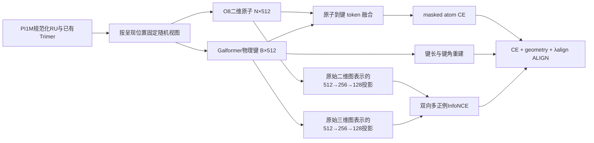
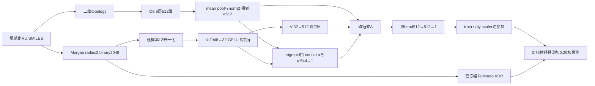

# 当前模型的完整数据流与架构

本说明依据实际源码与保存配置，记录时间见 [证据快照](evidence/execution_status.json)。当前研究主线为 UA_2D 的新 ALIGN20k 预训练＋下游 FP GATE；最佳已有完整七任务预测政策是 F_CE/G05 的 r10 全局预测融合。两者的 parent、输入和微调配方不同。

## 1. 数据、划分与统计口径

- 预训练：PI1M direct 来源 `data/processed/mcl_ph_r4_20260930/pi1m_direct_01.staging/`，排除已登记下游重叠，train 911,391 条；使用已有有限 Trimer 构象，不新生成构象。训练20k×global batch1008＝20,160,000次呈现，不是两千万个独立分子。
- 下游：`downstream_direct_01.staging/`。七任务按 Eea/Egb/Egc/Ei/EPS/Nc/Xc 顺序样本数为368/561/3380/370/382/382/432，总5,875。规范化重复单元 SMILES 保留连接 dummy atoms。
- `mips_paper5_outer`：outer `KFold(5, shuffle=True, random_state=100)`；sorted outer-train 中 `train_test_split(test_size=0.20, random_state=42)`，约64%训练、16%validation、20%test。按任务CSV行划分，不是scaffold split；行互斥不保证结构互斥。
- 每任务五折、每折seed42+fold，当前std为ddof=0；先对五折R²取均值，再对七任务等权macro。不跨物理单位平均RMSE，也不用pooled R²替代该口径。旧八任务grid的ddof=1另列，不能混入当前参考。
- scaler仅本fold train标签拟合；训练标准化MSE，validation预测逆变换后按原单位RMSE选择best。共享validation/TEST已参与开发，不是独立盲测；论文数据和精确split等价性未核实，Egc/Xc历史样本量有差异。

## 2. 共用二维主干 O8

源码：[glt_dual.py](../../src/modules/glt_dual.py)、[数据构造](../../src/dataset/glt_dual.py)。

canonical RU每原子137维化学特征＋1维backbone标记，138→512投影；六层hidden512、八头Transformer。周期lifted局部关系保留0/1/2 hop及位移身份，attention bias组合SPD、初始原子路径表示与最多两条键的14维化学特征。输出 N×512 原子表示，按canonical graph做mean pool，得到G×512。

实际 `SourceAttention512` 为source-Q、target-K、incoming softmax，缩放512^(-1/2)，不要仅按常见head-dim缩放猜测其实现。二维状态只编码canonical RU，不把整个Trimer复制成二维图。

## 3. 三维教师／融合分支

GalformerTrimer3D是项目改造的物理重原子键token模型：两端元素／键类型与256维条件Gaussian距离基经MLP得到512维键token；键角路径Gaussian与位置MLP提供bias，六层512维、八头Transformer沿真实line graph的一／二hop传播。padding及synthetic self不作几何监督目标。

当前P_ALIGN/F_CE配置为 `glt_periodic_seam_r1`、`finite_incident`、incident readout、角度值输入开启。真实跨RU键参与编码；incident读出按中心原子的实际入射关系处理中心几何信息。无几何时保留二维fallback，不伪造有效3D。`periodic_template`是另一条已实验的局部周期观测方案，不能把finite Trimer说成全局周期构象。

原子query对同图物理键key/value执行四头×32的token cross-attention，投回512维并加残差。融合原子池化/norm2与几何池化/norm3各512维，concat1024，再接1024→512→GELU→Dropout→1任务head。F_CE下游共39,876,344参数。

## 4. 新 P2 ALIGN20k 的真实预训练流程

- 原子掩码比例0.30，沿现有BRICS motif方案；物理RU副本的masked元素同步unknown，避免几何侧拷贝元素标签。噪声σ=0.03。atom CE从融合原子状态读入，而ALIGN从融合前raw二维/三维图表示读入。
- geometry是原键长／角重建，decoder前非仿射LayerNorm；不是FGR。`third_task=none`与`align_enabled=true`可同时成立：ALIGN在当前fusion revision中是显式附加目标。
- 两个512→256→128投影，共328,448参数，L2 normalize后双向多正InfoNCE；相同结构身份可有多个正例，invalid/padding不进负例池，temperature0.1。λalign前1000步线性升至0.1；CE和geometry权重均1。
- 从原U1 P_ALIGN step0模型张量重新训练，优化器新建，不是从step5000续训。seed42、BF16、AdamW lr0.0002、WD0、clip1、warmup2000、schedule20000、end_lr1e-9。
- 物理GPU2/3各一rank，micro84、accum6、global1008；两rank每次前向候选池最多168，旧四rank为336。累积6次不等于InfoNCE池1008。新旧差异包含rank/RNG和PT长度，不能作为单因素长度结论。
- 训练内过程validation仍为step1000/2500/5000各固定1024次呈现；不据此选择下游checkpoint。每5000步保存resume＋deploy，固定20k用于G2，不对4个checkpoint做下游搜索。
- `resume_XXXXX.pt`包含训练模型/监督heads/optimizer/RNG/采样位置；`deploy_XXXXX.pt`供下游恢复encoder，去掉预训练监督head。step0、resume、deploy、下游best不能互换使用。
- PT不输入FP，不训练FP GATE，也没有FP teacher、FP重建或属性标签监督。FP masked重建在旧设计附件中仅是可选提案，未在P2执行。

入口：[run_ua2d_pt20k.py](../../scripts/run_ua2d_pt20k.py)、[P2配置绑定](../../src/training/ua2d_pt20k.py)、[共享PT](../../scripts/pretrain_glt_dual.py)。

## 5. UA_2D 与当前 GATE 模型

旧UA_2D来自U1/P_ALIGN step5000，推理只有O8、mean pool、norm2与512→512→1 head，共19,262,233参数。`Pure2DGLTModel/restore_pure_2d`不构造Galformer；旧reader仍解码包含Trimer的存量记录，解码不等于forward使用三维。

当前G2固定新P2 step20000，抽取相同O8/norm2，复用原task/fold head初态，再接轻量GATE：[模块](../../src/modules/ua2d_fp_gate.py)、[运行辅助](../../src/training/ua2d_fp_gate.py)。

$$
p=\sqrt{512}\,x/\lVert x\rVert_2,\qquad q=\operatorname{GELU}(Up),\qquad \Delta=Vq
$$

$$
g=\operatorname{sigmoid}(W_g[a;q]+b_g),\qquad a'=a+g\Delta,\qquad \hat y=H(a')
$$

- REAL输入真实2048位binary Morgan，radius2、chirality/bond type/ring membership开启，保留dummy atoms；NULL每位0.5，经同样归一化。NULL仍有相同容量和可学习门，不能叫无参数基线。
- U为2048→32，V为32→512，均含bias；门为544→1的单样本scalar，形状B×1并广播到512维。没有向量门或多候选搜索。
- 隔离CPU RNG、seed20261017共用初始化；V weight/bias零，门weight零、bias log(0.1/0.9)，初始g=0.1、Δ=0，因此a'=a。新增83,009参数；G2总19,345,242，head阶段共346,178可训练参数。
- 起始V可获梯度；V更新后U/门应接通梯度。头阶段冻结O8/norm2并保持eval，训练GATE和原regressor；joint全量训练。禁止缓存head输入特征，以免缓存绕开训练中的GATE。
- G2所有任务统一 `uniform_u1`：head10＋joint60 epoch、batch24、FP32、workers0、WD0.02、encoder dropout0、head dropout0.1；head LR0.0003，joint backbone0.0001/head0.001；head cosine10/eta0.00003，joint WarmRestarts10/eta0.000001，clip5。train-only standard MSE，最小原单位validation RMSE选best。
- 两臂×七任务×五fold＝70FT，4900epoch、112,000更新；全部best冻结后才进行本周期正式预测。相同20k parent下REAL−NULL检验FP信息；不能据此宣称可学习门优于固定残差，也不能直接命名interaction。
- 本轮静态交接修正：`restore_pure_2d(..., expected_step=20000)`，避免默认5000校验拒绝新parent。没有重启PT或提前运行G2/CPU suite；运行时的实际源码会由G2单独保存。

## 6. r10预测融合的含义与迁移限制

已有最佳参考是 **G05神经模型＋Morgan/Tanimoto KRR** 的预测数组融合，不是上述GATE，也不是新encoder。

$$
\hat y_{\mathrm{final,raw}}=0.75\hat y_{\mathrm{neural,raw}}+0.25\hat y_{\mathrm{KRR,raw}}
$$

KRR以radius2/2048 binary Morgan的Tanimoto相似度为核；train-only目标标准化，α∈{0.1,1,10}在r9按本fold的0.5融合validation RMSE选取。r10固定已有α、模型和数组，在w∈{0,0.25,0.5,0.75,1}中按35个validation R²均值选择一个全局神经权重，exact tie选较大w，得到0.75。正式macro R²为0.796，validation macro为0.816，不能混称。

G2沿用该0.75输出政策及已有核结果，禁止新fit、重选α或新权重搜索。按task/fold/original_row/sample_key对齐原尺度truth、scaler与预测后才做算术；不按数组位置盲拼，不clip，不用TEST拟合。UA_FIXED75是旧UA预测＋相同KRR的参照；A_GLOBAL独立搜索未完成，不可混入当前G2。

G05来自两rank、geometry权重0.5的另一个parent，使用旧任务配方（Egc joint50，Xc有LR/WD/dropout特例）；UA/G2是uniform_u1。因此跨G05/r10与UA/G2的差值包含parent、目标、head维度和FT配方混杂。

## 7. 运行与交付边界

当前实验仅GPU2/3；一个PT周期、两rank，预训练最多2路，FT两卡总并发4，含预留及外部作业。CUDA出生握手负责NVML与容器/proc不同PID视图的归属，不用PID数值偏移。所有长任务在tmux `Uni-Poly`独立window，有命令、cwd、stdout/stderr和真实退出。

P2→G2→best冻结→正式神经预测与固定融合→唯一最终CPU suite依序自动接续。按用户要求，起始更新正常后已停止Codex主动监控。当前状态见带时间的[执行快照](evidence/execution_status.json)；GitHub不是实时训练监视器。

原数据、checkpoint、完整日志及逐样本预测只在训练机，远程只公开研究代码、说明和精简统计。若远程审查需要未上传证据，由Codex从现存产物只读导出，不重跑模型。旧E0/E1及A1另有未关闭问题，详见[实验目录](EXPERIMENT_CATALOG.md)，不把组件可用当作整个旧周期通过。
